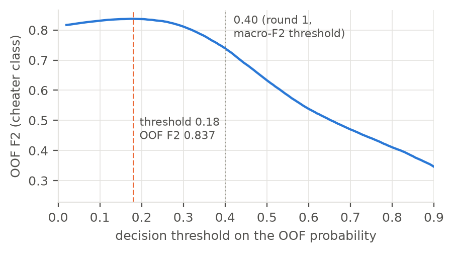
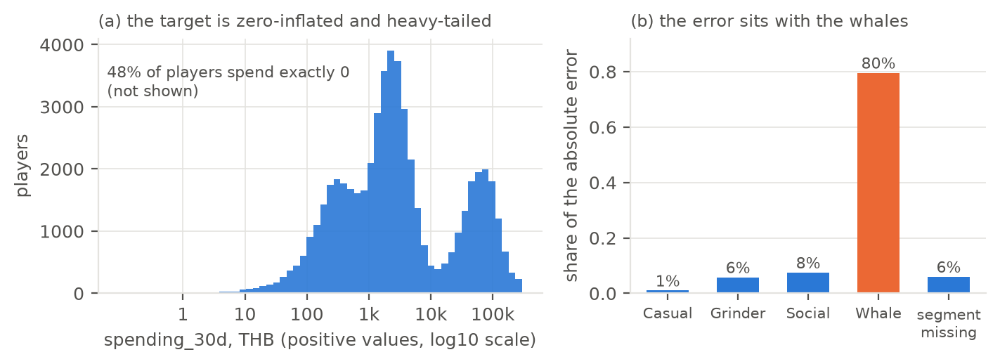
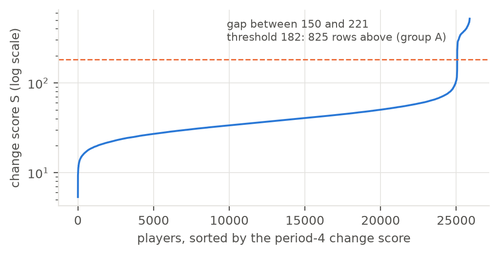
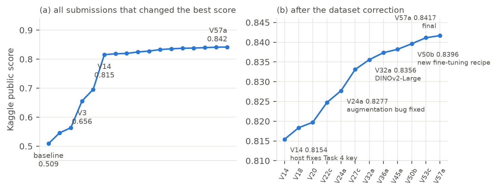

# CPE342 Karena Player Intelligence System: Technical Report

## 1. Introduction

### 1.1 Objectives
The project asks for a Player Intelligence System for the fictional publisher Karena Thailand, made of five models that feed a player lifetime-value view: an anti-cheat pre-filter (Task 1), a player-segment classifier (Task 2), a monthly-spending regressor (Task 3), a game-title detector for screenshots (Task 4) and an unsupervised account-security detector (Task 5). Each task is scored with its own metric and the Kaggle score is their weighted mean. The objectives of this report are to

1. describe the methodology of every task (EDA, preprocessing, model design, results) and the code that produced the submitted files;
2. record the insights and the mistakes that cost us time, so that they are not repeated;
3. connect each model to the business problem it addresses;
4. document the team's work, the lessons learned and what we would do next.

### 1.2 Overview of the approach
**Table 1.** Overview of the five tasks and the final method of each.

| | Task 1 | Task 2 | Task 3 | Task 4 | Task 5 |
|---|---|---|---|---|---|
| Problem | cheater pre-filter, binary | player segment, 4 classes | 30-day spending, regression | game title from a screenshot, 5 classes | account anomaly detection, unsupervised |
| Metric | F2 (cheater class) | macro F1 | NMAE score | macro F1 | F3 (anomaly class) |
| Final method | LightGBM (raw + engineered features), threshold 0.18 | LightGBM, noise columns dropped, tuned class weights | two-stage lognormal-median models + L1 LightGBM blend | ensemble of 25 fine-tuned backbones (DINOv2-L/B, ConvNeXt), class-prior correction | gap-based groups, missing-value classifier, tail rows |
| Quality | OOF F2 **0.837** | OOF macro F1 **0.7524** | OOF score **0.7907** | held-out clusters 0.98 (single DINOv2-B); estimated about 0.94 on the test set | F3 **0.883** measured for the first 1,806 flags; estimated about 0.89 for the final flags |

Our final public Kaggle score is **0.84167** (file V57a). The two files selected for the final ranking are **V57a (0.84167)** and **V53c (0.84113)**. On 2026-11-24 the public leaderboard showed us 14th of 22 teams (the leader 0.87346, the host's baseline entry 0.72601). Final private score and rank: [TEAM: final private score & rank].

The task weights are not readable in the text of the instruction slides (slide 26 gives only the formula). The leaderboard behaves as if the five tasks have equal weights of 1/5 (section 4.4). Under that assumption Task 4 is estimated at about 0.94: 5 x 0.84167 = 4.208, minus Tasks 1, 2, 3 and 5 (0.837 + 0.752 + 0.791 + about 0.89), assuming that the out-of-fold scores of Tasks 1-3 hold on the test set.

### 1.3 Supporting material
- **Final code** (the code root in the paths of this report: `runs/wirachat/final/` on branch `runs/wirachat`): `task1/` ... `task5/` with one notebook per task (Task 4: training script and ensemble notebook), `make_submission/`, `README.md` and `requirements.txt`, laid out as on slide 6. Executed with the saved Task 4 probabilities, it reproduces the two selected Kaggle files exactly (every column identical).
- **Experiments** (trial and error, alternative models, every Kaggle score): `runs/wirachat/round-1`, `round-2`, `round-3` and their `notes.md` files; they are kept in separate folders from the final code and are not needed to reproduce the submission.
- **Figures and the script that draws them:** `runs/wirachat/report/`.

## 2. Experimental setup

### 2.1 Data and competition rules
The host released the data on 2026-11-02 and **corrected it on 2026-11-12**: Task 2 and Task 5 got new datasets, and the Task 4 `test.csv` was replaced by a file keyed by the answer ids (the old file listed the images in a different order from the answer key; see section 5). Tasks 1 and 3 were unchanged. All final results use the corrected release.

**Table 2.** Competition rules (slide 13) and how we complied.

| Rule | Compliance |
|---|---|
| Provided datasets only; combine Train+Val for training | Only the Kaggle files were used; the final models are trained on all training rows (Task 4: all training images). |
| No test-set usage for training (no pseudo-labelling or fine-tuning) | No test label exists for us and no model was trained on test predictions. Task 5 has no training file, so its analysis is unsupervised on the test features (section 2.4). |
| Task 4 may use pretrained models; Tasks 1, 2, 3, 5 train from scratch | Tasks 1, 2, 3, 5: LightGBM / scikit-learn models trained on the task's own data only. Task 4: pretrained DINOv2 and ConvNeXt backbones fine-tuned on the training images. |
| Feature engineering and ensembling encouraged; AutoML prohibited | Hand-built features and ensembles; no AutoML tool was used, hyperparameters were set by hand and small searches. |
| Work only with your team; no sharing of code or predictions | No code or predictions were shared with other teams. |

### 2.2 Environment
**Table 3.** Hardware and software used for the final results.

| Item | Value |
|---|---|
| Computer | Windows 11 laptop, 16 CPU threads, NVIDIA RTX 4060 Laptop GPU (8 GB) |
| Python and libraries | Python 3.11.9, numpy 2.4.6, pandas 3.1.1, scikit-learn 1.9.1, SciPy 1.17.1, LightGBM 4.7.0 |
| Deep learning | PyTorch 2.6.0 (CUDA 12.4), torchvision 0.21.0, timm 1.0.15, huggingface_hub 2.4.0 |
| Pretrained weights | DINOv2 ViT-L/14 and ViT-B/14 (`lvd142m`), ConvNeXt-Base (ImageNet-22k), ConvNeXt-Small/Tiny (ImageNet-1k); a CLIP ConvNeXt-B was tried and dropped. Licences from the model cards: DINOv2 ViT-L/14 and ViT-B/14 (timm `lvd142m`) Apache-2.0; ConvNeXt-Base 22k (timm `fb_in22k_ft_in1k`) Apache-2.0; CLIP ConvNeXt-B Apache-2.0. ConvNeXt-Small/Tiny weights come from torchvision (package licence BSD-3-Clause) |
| Seeds | 342 for every split and tabular model; each Task 4 member has its own seed (see `final/task4/train_all_members.sh`) |
| Compute time | Tasks 1, 2, 3, 5: minutes each. Task 4: about 130 GPU hours for the 25 members of the final ensemble (6.5 h per baseline DINOv2-L, about 8 h per new-recipe DINOv2-L) |

### 2.3 Validation strategy
- **Tasks 1, 2, 3:** 5-fold stratified cross-validation with seed 342 (Task 3 stratified by segment x zero/non-zero spending). Out-of-fold (OOF) predictions are used to pick thresholds, class weights and blend weights, and the OOF score is our estimate of the test score. For Task 1 we checked that the different missing-value pattern of the test file costs only 0.0009 AUC when imitated on validation folds.
- **Task 4:** a split by cluster: 300 k-means clusters of DINOv2-small embeddings of the training images, 60 clusters (6,000 images) held out. It gave 0.965-0.98 macro F1 but cannot measure the shift between the training and the test image sources (section 3.4), so it was used only to compare training recipes; the public leaderboard was used to judge the ensemble.
- **Task 5:** no labels, so no validation. The only feedback is the leaderboard.

### 2.4 Notes on data use and tooling
1. **Class-prior (EM) adjustment in Task 4.** The class mix of the test images differs from the training mix. After the ensemble has predicted the test images, the test class shares are estimated from the predicted probabilities with the Saerens EM algorithm (no labels involved) and the probabilities are multiplied by the estimated shares (alpha 1; a label-shift correction). No test label, pseudo-label or fine-tuning is used. It is worth +0.0017 to +0.0019 on the public leaderboard (same members with and without it: V31a 0.83419 vs V31c 0.83248; V41a 0.83782 vs V41b 0.83615; V57a 0.84167 vs V57b 0.83980). Both final submissions (V57a, V53c) include it.
2. **Task 5 has no training file**, only `test.csv`, so all Task 5 analysis (gap discovery, the missing-value classifier) is unsupervised and fitted on the Task 5 test features. No labels are involved, but it is test-set analysis by nature.
3. **Use of leaderboard scores.** Public-leaderboard scores of single-change submissions (ablations) were used to verify how each metric behaves (the plain F2 and F3 of the positive class rather than macro averages), to detect that the original Task 4 file format was wrong (section 5), and to see how sensitive the total score is to each task. No test labels were accessed.
4. **Test-image statistics motivated augmentations.** In round 2 we compared brightness and colour statistics of test and train images (test images are darker and more saturated), which motivated the colour and brightness augmentations used in Task 4.
5. **Tools.** The code was written and run with an AI coding assistant (Claude Code) working under the branch owner's direction: the owner set the goals and approved every Kaggle submission (uploaded through the Kaggle website or command line), and the results were verified against the Kaggle scores and by re-running the final notebooks.
6. **Submission limit.** The Kaggle limit of about five submissions per day is shared by the whole team, which limited how many ideas could be tested on the leaderboard.

## 3. Methodology per task

### 3.1 Task 1: Anti-cheat pre-filter (binary classification, F2)
**EDA.** The training file has 104,000 rows and 33 columns: the identifier `player_id`, the 31 features of the datacard (kill/death ratio, headshot percentage, win rate, accuracy, reaction time, reports received, ...) and the target `is_cheater`. Slide 15 speaks of "33 features total (32 predictive + target)", which counts `player_id` among the 32; the identifier carries no information and is not used. 13% of the labels are missing (90,816 labelled rows); 34.9% of the labelled accounts are cheaters. The test file (25,889 rows) has a different per-column missingness: for example `headshot_percentage` is missing in 2.7% of the training rows and in 14.1% of the test rows, while `avg_session_length_min` is missing in 23% of the training rows and in 1.6% of the test rows (an adversarial classifier separates train from test with AUC 0.90 on the missingness alone), but the distributions of the observed values are the same (KS about 0.01 per column, same correlation structure). Accounts with `reports_received` above 27.6 are never cheaters (1,011 rows).

**Preprocessing and features.** Rows without a label are dropped. Missing feature values are kept as NaN (LightGBM routes them natively). Five engineered features were added for one of the two models: number of missing values, reports per account age, kill/death x headshot, accuracy x aiming smoothness, reaction time x input consistency.

**Model design.** Two LightGBM binary models (raw columns; raw + engineered), learning rate 0.03, 31 leaves, minimum 40 rows per leaf, feature and bagging fraction 0.7 / 0.8, L2 5, early stopping after 150 rounds (700-1,300 trees per fold), 5-fold stratified CV. The test probability is the mean of the five fold models, then the mean of the two variants. The decision threshold is chosen on the OOF probabilities for the plain F2 of the cheater class (Figure 1).

**Results.** OOF AUC 0.8911 (raw), 0.8906 (engineered), 0.8914 (average); OOF F2 **0.837** at threshold 0.18 (the OOF optimum is 0.175 with F2 0.8373). At 0.18 the model flags 15,597 of the 25,889 test accounts (60.2%).

**Table 4.** Task 1: what we compared (OOF, 5-fold).

| Model | Result |
|---|---|
| Logistic regression | AUC 0.765 |
| GPU MLP | AUC 0.8145 |
| LightGBM, 4-leaf trees | AUC 0.8899 |
| LightGBM raw / engineered / average | AUC 0.8911 / 0.8906 / 0.8914 |
| LightGBM + XGBoost + CatBoost blend | F2 0.8370 (LightGBM alone 0.8373) |
| Threshold 0.40 (macro-F2 optimum, round 1) vs 0.18 (plain-F2 optimum) | Kaggle score 0.54617 -> 0.56346 |

**Insight and common mistake.** The Kaggle page says "F2 (Macro)" but the score behaves like the plain F2 of the cheater class. Round 1 tuned a macro-F2 threshold (0.40); switching to the plain-F2 threshold (0.18) raised the leaderboard score by +0.0173, close to the +0.0196 predicted from the OOF scores for one task out of five. The model is saturated: four-leaf trees already reach AUC 0.89.

### 3.2 Task 2: Player segment classification (4 classes, macro F1)
**EDA.** The corrected training file has 104,000 rows and 44 predictive columns; class shares 0.394 (Casual), 0.250 (Grinder), 0.202 (Social), 0.154 (Whale). Ten columns are categorical (region, platform, device, payment method, language, account status, player type tag, engagement level, loyalty tier, skill tier). Each numeric column is missing in about 7.7% of the rows, `region` in 26% and `payment_method` in 31%; missingness carries no information about the class. Three `random_metric*` columns are pure noise. Train and test are statistically identical (adversarial AUC 0.50) and there are no gapped sub-populations.

**Preprocessing and features.** The three noise columns are dropped (41 features remain), categoricals are pandas categories with the training categories, NaNs are left to LightGBM.

**Model design.** LightGBM multiclass (same parameters as Task 1), 5-fold stratified CV. The test probability is the mean of the fold models. Class weights multiplied onto the probabilities are tuned by coordinate search on the OOF predictions to maximise macro F1; the final weights are [0.85, 0.90, 1.00, 1.00].

**Results.** OOF macro F1 **0.7512** (argmax) and **0.7524** (weighted); the five folds range from 0.749 to 0.752. Predicted test shares [0.416, 0.249, 0.195, 0.140] against the training shares [0.394, 0.250, 0.202, 0.154].

**Table 5.** Task 2: model comparison (OOF macro F1).

| Model | macro F1 |
|---|---|
| GPU MLP | 0.7253 |
| Logistic regression | 0.7506 |
| LightGBM, argmax | 0.7512 |
| LightGBM, tuned class weights (final) | 0.7524 |

**Insight.** Logistic regression matches boosting, so the relation is essentially linear and 0.75 is the ceiling of the data; further model complexity would not help, and the effort was better spent on other tasks.

### 3.3 Task 3: Player monthly spending (regression, NMAE)
**EDA.** 104,000 training rows, 32 features. 48.1% of the targets are zero (zero share by segment 72 / 48 / 31 / 7%), the median is 79 THB, the mean 10,497 THB and the top 1% of the players hold 19% of the total spending (Figure 2a). The identity `historical_spending = total_transactions x avg_transaction_value` holds for 99% of the rows where all three values exist; the player `segment` is missing in 5.7% of the rows and can be recovered from the other columns with 92% cross-validated accuracy. The positive part of the spending is almost deterministic (log-space R2 0.99) whereas whether a player spends at all is mostly random (AUC 0.78 overall, 0.56-0.63 within a segment).

**Metric.** `NMAE = 1 / (1 + sum|y - y_hat| / sum y)` is an absolute-error metric on the raw scale, so the best prediction is the **conditional median**, not the mean. Training a model on squared error, or averaging predictions of a log-model back-transformed with the mean, is the scaling mistake the slide warns about.

**Preprocessing and features.** Missing `historical_spending` is filled with `total_transactions x avg_transaction_value` (exact identity), then with a noisy fallback from the previous month; missing `total_transactions` and `avg_transaction_value` are filled from the identity; missing segments are filled by a LightGBM classifier (used only where the segment is missing). Added: log versions, `prev_month_spending / historical_spending`, spending per account age.

**Model design.** Three LightGBM models on the same folds, blended with fixed weights and clipped to [0, 300000]:
- **A, two-stage on the raw features:** a binary model gives P(spending = 0); an L2 model on log-spending fitted on the positive rows gives the log-mean; a lognormal sigma per segment turns them into the conditional median (prediction 0 when P(zero) >= 0.5).
- **B, L1 LightGBM on the identity features:** direct median regression (absolute-error objective).
- **C, two-stage on the identity features.**
- Final prediction = 0.55 C + 0.25 A + 0.20 B.

**Results.**

**Table 6.** Task 3: OOF NMAE score of each model.

| Model | OOF score |
|---|---|
| Median of six L1 LightGBM models (round 1) | 0.7854 |
| A: two-stage, raw features | 0.7884 |
| B: L1, identity features | 0.7863 |
| C: two-stage, identity features | 0.7900 |
| Blend 0.5 A + 0.5 B (earlier final, file V53c) | 0.7896 |
| **Blend 0.55 C + 0.25 A + 0.20 B (final, file V57a)** | **0.7907** |

Scaling the predictions, changing the clip and a finer blend search added nothing; a GPU MLP was worse (log-residual sd 0.242 against 0.225). Knowing the zero outcome exactly would add only about +0.008 to the leaderboard score, so the target is close to its ceiling.

### 3.4 Task 4: Game title detection (5 classes, macro F1)
**Data.** 230 x 120 screenshots of 7 Knights, FiveN, Free Fried, PUBE and Roblock; 31,546 training and 25,889 test images; training class shares 0.39 / 0.14 / 0.18 / 0.19 / 0.10. The test images come from different sources than the training images: only 0.08% of the test images have a training neighbour with DINOv2 cosine similarity above 0.95 (2% within the training set), the median nearest-neighbour similarity is 0.804 test-to-train against 0.840 within train, and the test images are darker and more saturated. The test class mix differs from the training mix (the ensemble predicts about 15 / 27 / 15 / 24 / 19%).

**Preprocessing and augmentation.** Images are resized to 224 x 448 (they are wide). Training augmentation is strong and class-independent: random resized crop, flip, rotation up to 45 degrees, channel shuffle, colour jitter, grayscale, equalize / autocontrast / posterize / solarize, down-up resampling, blur, noise and random erasing. A new random augmentation is drawn in every epoch (section 5 explains why this matters).

**Model design.** Each member is a pretrained backbone fine-tuned end to end on all training images with class-balanced cross-entropy (label smoothing 0.1), AdamW, one-cycle learning rate and fp16. Test-time augmentation depends on the member: the five ConvNeXt members (ConvNeXt-B 22k in three versions, ConvNeXt-Small, ConvNeXt-Tiny; 16 of the 316 weight units) average three scales (0.8, 1.0, 1.25) and a horizontal flip, while the 20 DINOv2 members (all ViT-L and ViT-B members, `--scales 1.0`) are predicted at a single scale with a horizontal flip. The best members use a **new recipe**: layer-wise learning-rate decay (0.9 for ViT-L, 0.8 for ViT-B), an exponential moving average of the weights (0.999; the averaged weights make the predictions) and CutMix / MixUp on half of the batches. The ensemble is a weighted probability average followed by the class-prior correction of section 2.4.

**Table 7.** Task 4: composition of the final ensemble (file V57a).

| Members | Weight each | Total | Share |
|---|---|---|---|
| 6 x DINOv2-L, new recipe (seeds 201-206) | 33 | 198 | 62.7% |
| 1 x DINOv2-B, new recipe (seed 301) | 20 | 20 | 6.3% |
| 10 x DINOv2-L, baseline recipe (lr 2e-5, no layer decay / EMA / mixing) | 7 | 70 | 22.2% |
| ConvNeXt-B 22k (224x448, seed 5, 288x576) and DINOv2-B (3 seeds) | 4 | 24 | 7.6% |
| ConvNeXt-Small, ConvNeXt-Tiny | 2 | 4 | 1.3% |

The new-recipe members hold 218 of 316 weight units (69%). V53c uses four new-recipe DINOv2-L (49 each) and a DINOv2-B new-recipe model trained on 80% of the images (20).

**Results and what moved the score.** The held-out-cluster macro F1 of a single DINOv2-B is 0.976 with the baseline recipe and 0.983 with the new one, but the test set is a shifted source, so we report the leaderboard (Figure 3a, Table 8). Task 4 is estimated at about 0.94 on the test set (section 1.2).

**Table 8.** Task 4: the experiments that mattered (Kaggle public score).

| Change | Score | Comment |
|---|---|---|
| ConvNeXt-Tiny, corrected key | 0.81542 | first working Task 4 file (V14) |
| 224x448 input, stronger augmentation, multi-scale TTA | 0.81835 | resolution and augmentation help |
| class-prior (EM) correction | 0.81941 | +0.0011 (later +0.0017 to +0.0019) |
| ConvNeXt-B 22k and DINOv2-B, weight 3 | 0.82473 | big backbones beat more copies of small ones |
| **augmentation bug fixed** (`--fresh-aug`) | 0.82772 | +0.0030 for one replaced model |
| fresh DINOv2-B, then drop the old models | 0.83096, 0.83227 | old members were dead weight |
| four fresh members at equal weight | 0.83419 | |
| CLIP ConvNeXt-B added | 0.83235 | a weaker, different member hurt; dropped |
| 288x576 resolution | 0.83354 (0.83352 before) | resolution is not a lever |
| DINOv2-L added | 0.83558 | +0.0014 |
| 4, 8, 10, 11 baseline DINOv2-L seeds | 0.83735, 0.83803, 0.83820, 0.83816 | plateau at about 10 seeds |
| 12-epoch variant, weight tweaks | 0.83720 and below | flat or negative |
| **new recipe**, 1 DINOv2-L (33% of the weight) | 0.83960 | +0.0014, largest step since DINOv2-L |
| new recipe, 2 models (67% of the weight) | 0.84073 | still rising |
| 3 models at 75% of the weight | 0.84060 | share past its peak |
| new recipe, 4 models (67%), + DINOv2-B | 0.84106, 0.84113 | |
| new recipe, 5 models + DINOv2-B | 0.84109 | plateau inside the public noise (about 0.0002) |
| 6 models + DINOv2-B + improved Tasks 3 and 5 | 0.84167 | final file V57a |

### 3.5 Task 5: Account security monitoring (unsupervised, plain F3)
**Data.** 25,889 players x 122 features: 29 behaviour columns observed in four time periods, plus 6 static columns (for example `behavior_stability`, `password_changed`, `vpn_usage`, `suspicious_login_time`, `mass_item_sale`). Only `test.csv` exists. The dataset was replaced on 2026-11-12 (same ids, new order, 99.8% of the values changed), so the analysis was redone from scratch.

**EDA.** Normal columns are uniform latent values plus per-period noise (kurtosis about -1.2), so a column of normal accounts has no tails. Anomalous accounts shift one main column plus one to three side columns, and each shift leaves an **empty gap** in the histogram of the column.

**Metric insight.** The score behaves like the plain F3 of class 1, `F3 = 10 TP / (9 T + n)` with T true anomalies and n flagged rows. A flag therefore helps if and only if its probability of being an anomaly exceeds F3/10, about 9%: flagging should be generous, unlike under F1. In an ablation where Task 5 was reduced to a single flagged row, the public score dropped by 0.17664, so the F3 of our first 1,806 flags is 0.883; under the formula this corresponds to about 2,070 true anomalies (8.0%) at about 100% precision (or about 2,000 at 97%).

**Method.**
1. **Group A, change in period 4 (825 rows).** For each row the sum of capped squared robust z-scores of (period 4 - mean of periods 1-3) over all behaviour columns. The sorted scores have a clean gap between 150 and 221 (Figure 4); rows above 182 are flagged. They show account-takeover patterns (location jumps, currency transfers, purchases; password change 40%, mass item sale 28%) and skill boosting or selling.
2. **Persistent low groups.** A gap scan outside group A finds 21 columns with an internal gap. Grouped by family, a row belongs to a family when it is on the small side in at least two periods (static column: one). No row is in two groups except that one set of 207 rows is low in three columns at once.
3. **Missing behavior_stability (+49).** 1,168 unflagged rows have this value missing and are invisible to step 2. The low-stability group has side effects (more purchases, fewer logins, older accounts), so a gradient-boosting classifier that recognises the group from its side effects (OOF AUC 0.982) scores these rows; rows with P > 0.09 are flagged, as the F3/10 rule says. Adding these 49 flags raised the public score by 0.00095 (Task 5 +0.0048, measured on a submission that changed nothing else); with the F3 formula this implies about 14 true anomalies among the 49, more than the 8 the classifier had expected.
4. **Two tail rows (+2).** Two unflagged rows jump 34 and 57 degrees in login location and have onset scores (periods 3-4 against 1-2) of 243 and 237, far above the next largest (188); both have 13-14 missing values, which is why the period-4 rule missed them.

**Table 9.** Task 5: the flagged groups.

| Group | Rows | Main feature |
|---|---|---|
| A: change in period 4 | 825 | takeover patterns, skill boosting |
| low `behavior_stability` | 246 | static column |
| low `login_time_variance`, `ip_hash_entropy`, `session_duration_std` | 207 | bot-like (same rows in all three) |
| low `communication_frequency` | 263 | gapped in all four periods |
| low `activity_level` | 265 | gapped in two of the four periods |
| **total of the groups** | **1,806 (6.98%)** | |
| + missing `behavior_stability` classifier | +49 | +0.00095 on the leaderboard (measured); implies about 14 true anomalies |
| + tail rows | +2 | rows 8038 and 14925 |
| **final flags** | **1,857 (7.17%)** | |

**What did not work.** Isolation Forest at 5% contamination (our baseline; it finds only 6% of the activity group), PCA reconstruction, LOF, Gaussian mixtures (BIC chooses eight components, only the known groups), gap scans on period means, slopes, within-row variance, location jumps and residual correlations, discrete-value and missing-value patterns. About 200 anomalies (T about 2,070 against 1,857 flagged) probably remain unflagged; this is the largest known loss in any task.

### 3.6 How the task-slide hints were addressed
**Table 10.** Hints from the task slides and what we did.

| Task | Hint | What we did |
|---|---|---|
| 1 | missing values | kept as NaN for LightGBM; missing-value count as a feature |
| 1 | class imbalance (resampling, weights, SMOTE) | 35% positives, moderate; no resampling or weights; the F2 threshold handles it |
| 1 | feature engineering, CV, threshold tuning, ensembles | five features; 5-fold CV; threshold from OOF; raw + engineered average (XGBoost/CatBoost blends tested, no gain) |
| 2 | Leverage Task 1, stratified K-fold | same pipeline; stratified 5-fold |
| 2 | XGBoost / LightGBM / CatBoost, stacking, interaction features | LightGBM; logistic regression and an MLP as controls; no stacking, because the signal is linear and the ceiling is the data |
| 3 | two-stage model, log transform | two-stage model (zero? then amount) and log-target models; final = lognormal median |
| 3 | boosting regressors, ensembling | LightGBM (L1 and L2), blend of three |
| 3 | target-scaling mistakes | the metric is an absolute error, so predict the median, not the mean |
| 4 | augmentation, class imbalance | strong augmentation drawn every epoch; class-balanced loss |
| 4 | VGG / ViT / Swin, cross-validation, ensembling, GPU | ConvNeXt and ViT (DINOv2); held-out clusters instead of CNN cross-validation (8 GPU hours per large model); 25-member ensemble; local RTX 4060 |
| 5 | Isolation Forest, One-Class SVM, auto-encoder | Isolation Forest tested as baseline and diagnostic; One-Class SVM and auto-encoder were not tried; structure-based groups scored far higher |
| 5 | ensembling, contamination | no voting ensemble; the number of flags follows from the gap thresholds and the F3 rule (9%) |

## 4. Results

### 4.1 Final submissions
**Table 11.** The two files selected for the final ranking and the file without the class-prior step.

| File | Public score | Task 3 | Task 4 | Task 5 flags |
|---|---|---|---|---|
| **V57a** (selected) | **0.84167** | blend 0.55 C + 0.25 A + 0.20 B | 6 new-recipe DINOv2-L + DINOv2-B + others, class-prior correction | 1,857 |
| **V53c** (selected) | 0.84113 | blend 0.5 A + 0.5 B | 4 new-recipe DINOv2-L + DINOv2-B (80% data) + others, class-prior correction | 1,855 |
| V57b (not selected) | 0.83980 | as V57a | as V57a without the class-prior correction | 1,857 |

Tasks 1 and 2 are identical in all three files. The notebooks in `final/` rebuild V57a and V53c from the data and the saved Task 4 probabilities; every column equals the file that was uploaded (Task 3: mean absolute difference below 0.0005).

### 4.2 Score history and standing

The ground baseline of the host scores 0.68 and the challenge baseline 0.75 (slide 27); the leaderboard's baseline entry shows 0.72601. Our final public score 0.84167 is 0.116 above that entry and 0.032 below the leader (0.87346). Final private score and rank: [TEAM: final private score & rank].

### 4.3 Contribution of each change
**Table 12.** Measured effect of the main changes on the public score (a single upload each, public-score noise about 0.0002).

| Change | Effect |
|---|---|
| Task 1 threshold for the plain F2 (0.40 -> 0.18) | +0.0173 |
| Task 5 groups instead of Isolation Forest (round 2) | +0.092 (0.5635 -> 0.6556) |
| Corrected Task 4 key and new Task 2 / Task 5 data (2026-11-12) | +0.12 (0.6958 -> 0.8154) |
| Augmentation bug fixed, one model replaced | +0.0030 |
| Fresh DINOv2-B replaces the old one | +0.0023 |
| DINOv2-Large added | +0.0014 |
| New fine-tuning recipe, first model | +0.0014 |
| Class-prior correction | +0.0017 to +0.0019 |
| Task 5 missing-value classifier (49 flags) | +0.00095 |
| Improved Task 3 blend + two Task 5 tail rows (with a six-model Task 4) | +0.00054 (V53c -> V57a) |

### 4.4 Task weights
The Task 1 threshold change raised the score by +0.0173 against +0.0196 predicted for equal weights (the OOF F2 gain of +0.098 divided by five). Cutting Task 5 to one flagged row (ablation upload) lowered the score from 0.81742 to 0.64078, a drop of 0.17664, consistent with the F3 of 0.883 for 1,806 flags divided by five. Both agree with equal weights of 1/5; this is an inference from the scores, not a statement from the course, and it would be worth confirming with the TAs.

## 5. Insights and common mistakes
**Table 13.** Mistakes and what they cost.

| Mistake or trap | Cost | How we found it and what we do now |
|---|---|---|
| Trusting the metric name on the page ("F2 Macro") | +0.0173 of score left unused until the threshold was changed | the leaderboard reaction to a threshold change showed it is the plain F2; read the metric from the behaviour of the score |
| Task 4 `test.csv` listed images in a different order from the answer key | Task 4 stayed at chance level (about 0.2) for the first ten days, whatever the model | the hosts fixed the file on 2026-11-12. Map predictions by id, never by row position, and check the key format before chasing model quality |
| Fixed augmentation per image (the dataset class re-seeded the random generators from the image index) | every image got the same augmentation in every epoch (16 of 16 identical); all models before 2026-11-15 were affected | found by inspecting two epochs of one image; fixing it gave +0.0030 for one model and made the old members dead weight |
| Trusting a high held-out score (0.97) | it hid the shift between the training and the test image sources | judge changes on the leaderboard, use the held-out split only for controlled comparisons |
| Adding a weaker, different model to an ensemble (CLIP ConvNeXt-B) | -0.0008 | members must be individually good; a second seed of a strong model helped, a different weak model did not |
| Keeping on adding seeds of a saturated recipe | ten DINOv2-L seeds gained only +0.0002 per seed at the end | a better recipe (+0.0014 from one model) beat more seeds |
| Optimising the mean for an absolute-error metric (Task 3) | a prediction biased away from the median (a trap we avoided, not a measured loss) | predict the conditional median (two-stage lognormal median, L1 objective) |
| Chasing public-score noise | many late changes were inside 0.0002 | stop at the plateau, spend submissions only on changes with a real expected gain |

Other insights: (1) logistic regression matching LightGBM (Task 2) shows that the data, not the model, limits the score; (2) structure in the data (gaps in Task 5, identities in Task 3) was worth more than model tuning; (3) the F-beta formulas decide thresholds and which rows to flag; (4) the missing values of a column can hide a group (Task 5) or differ between train and test (Task 1), so they need their own check.

## 6. Domain interpretation (link to business impact)
**Table 14.** What each model means for Karena (business problems from the task slides).

| Task | Business problem (slide) | What the model gives | How it would be used | Caveat |
|---|---|---|---|---|
| 1 | 10,000+ cheat reports a day, 500 reviewed, 70% false positives, about 15 million baht daily lost (slide 14) | a cheater probability per account | rank the report queue: review the highest probabilities first; the 0.18 threshold decides what must not be auto-dismissed | flagging 60% of accounts maximises F2 but is above the review capacity, so use the ranking, not the threshold, to fill the 500 slots |
| 2 | generic campaigns reach 2-5% engagement; whales are 5% of players and 60% of revenue (slide 16) | segment (casual, grinder, social, whale) | choose the message by segment (tournaments for grinders, cosmetics for whales, events for social players) | macro F1 0.75: roughly one player in four is misclassified, so test campaigns with a hold-out group |
| 3 | forecasts miss targets by 35-40%; VIP support misallocated; discounts given to whales (slide 18) | median 30-day spend per player | rank players for VIP treatment and offers | the model is a median predictor: it ranks well but under-forecasts the total; the whales cause 80% of the error, so monitor them first |
| 4 | 2,000 image tickets a day, 10+ minutes each to find the game; 50,000+ campaign screenshots checked by hand for 3% (slide 20) | game title of a screenshot | route tickets to the right team, verify campaign submissions, tag content for moderation | screenshots from new sources (streams, forums) shift the class mix: monitor the predicted class mix, which the class-prior step estimates |
| 5 | over 5,000 confirmed thefts a month, bots, account selling, VPN abuse; 60% false-positive rate of the rules (slide 22) | an anomaly flag with a group label | send each group (takeover, bot-like low-entropy accounts, skill boosting) to its own review queue | the F3 metric rewards recall: expect about 9% precision as the break-even; about 200 anomalies remain unflagged |

## 7. Team collaboration **[TEAM]**
Fill in: member names and roles, which tasks each member led, how results were shared, meetings, and what each member learned. Facts from the repository that can be used:
- Everyone works on a branch `runs/<name>` of the shared repository (rule: no pushes to `main` or to another member's branch; only code and notes are committed, no submission files).
- The daily Kaggle quota of about five submissions was shared across the team and was a real constraint.
- This branch (`runs/wirachat`) holds the work described in this report in three rounds (`round-1`: EDA and baselines; `round-2`: Task 3 and Task 5 methods and early Task 4; `round-3`: corrected data, Task 4 fine-tuning, final builds) and the final code in `final/`.

**Table 15.** Roles and takeaways.

| Member | Role / tasks | Main contribution | Takeaway |
|---|---|---|---|
| [TEAM] | | | |

## 8. Conclusion

### 8.1 Lessons learned
Correctness of the data and the format came first (the Task 4 key), then understanding of the metric (F2 and F3 thresholds), then model work. After that, the quality of the training (the augmentation fix, the new fine-tuning recipe) mattered more than ensembling more models of the same kind. The leaderboard noise (about 0.0002) is larger than the gain of most late changes, so stopping at a plateau saves effort and submissions.

### 8.2 ML insights
- Linear models matched boosting on Task 2: the ceiling can be the data, and diagnosing it early frees time.
- An unsupervised problem (Task 5) was solved by looking for structure (empty gaps and group side effects) rather than with a generic detector; the F3 formula told us how generous to be.
- For an absolute-error metric (Task 3) the median is the target, and a two-stage model handles a zero-inflated target naturally.
- With a shifted test source (Task 4), validation on the training distribution does not measure the real error, and the class mix of the test set is itself something to estimate.

### 8.3 Future improvements
1. Build a labelled proxy for Task 5 (simulate the six known group types) to search for the roughly 200 unflagged anomalies.
2. A validation set for Task 4 that mimics the source shift, for example a split by image source.
3. More new-recipe seeds at about two thirds of the weight, if GPU time allows; the gain per seed is now below the leaderboard noise.
4. Estimate the test class mix early and train with it in mind, instead of correcting only at the end.
5. Limits of this work: our final public score is 0.032 below the leader. We could not locate the gap: Tasks 1-3 are at their cross-validation ceilings, Task 4 plateaued, and the Task 5 anomalies that remain have no signal we could find. The private ranking may differ from the public one.

## Appendix A. Code layout and reproducibility
**Table 16.** Final code (paths relative to the code root, `runs/wirachat/final/`).

| Path | Content |
|---|---|
| `README.md`, `requirements.txt`, `run_all.py` | how to run, packages, runs all notebooks in order |
| `task1/task1.ipynb` ... `task3/task3.ipynb`, `task5/task5.ipynb` | final pipeline of Tasks 1, 2, 3 and 5 (EDA, features, model, OOF score, test output) |
| `task4/train_backbone.py`, `task4/train_all_members.sh`, `task4/README.md` | training of one member; the exact command of each of the 25 members; run guide |
| `task4/task4_ensemble.ipynb` | weighted average, class-prior correction, mapping to the test ids |
| `make_submission/make_submission.ipynb` | builds `submission_v57a.csv` and `submission_v53c.csv` and compares them with the uploaded files |

Run: set `CPE342_DATA` to the Kaggle download folder, `pip install -r requirements.txt`, then `python run_all.py`. Task 4 needs the saved member probabilities (about 130 GPU hours to retrain), supplied with the submission archive and not committed to git. Not committed either: submission files, model weights and data. Experiments are in `round-1..3` and are not part of the final code.

## Appendix B. Task 4 training commands
Baseline recipe, DINOv2-L (ten seeds): `--arch timm:vit_large_patch14_dinov2.lvd142m --h 224 --w 448 --bs 8 --epochs 8 --lr 2e-5 --scales 1.0 --fresh-aug --gc --workers 2 --seed S`.
New recipe, DINOv2-L (seeds 201-206): the same with `--lr 6e-5 --llrd 0.9 --ema 0.999 --ema-cpu --ema-every 8 --mix 0.5`.
New recipe, DINOv2-B (seed 301): `--arch timm:vit_base_patch14_dinov2.lvd142m --bs 16 --epochs 10 --lr 1e-4 --llrd 0.8 --ema 0.999 --mix 0.5 --scales 1.0 --fresh-aug`.
The ConvNeXt and DINOv2-B baseline members are listed in `final/task4/train_all_members.sh`.
